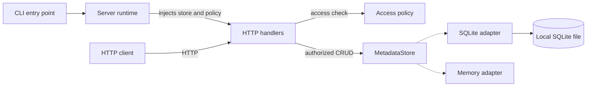
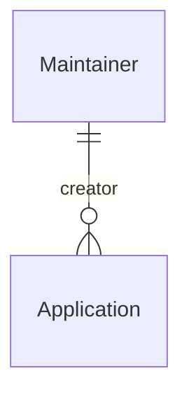

# Metadata API

[](https://github.com/henryzdai/metadata-api/actions/workflows/ci.yml)

Store application metadata and its creators through a Go JSON API.
Get full CRUD, SQLite persistence, and safe concurrent edits without a database server.

[API reference](openapi.json) | [Passing E2E run](https://github.com/henryzdai/metadata-api/actions/runs/39538710232) | [Workflow source](.github/workflows/ci.yml)

## Quick start

Use Go 1.27.2, the tested toolchain. The module requires Go 1.26 or later.
Normal builds need no C compiler.

Build and run from this directory:

```powershell
go run .\cmd\metadata-server
```

The server listens on `127.0.0.1:8080` and stores data in `data\metadata.db`.
Stop it with Ctrl+C. Run tests in another terminal:

```powershell
go test .\... -count=1
```

For a standalone Windows executable, run
`go build -o metadata-server.exe .\cmd\metadata-server`.
On Linux or macOS, use `./cmd/metadata-server` and `./...` instead.

Configure the address with `--listen`, the SQLite path with `--db`, or select
volatile storage with `--storage memory`.

Provider options use `--storage-option key=value`. See the
[storage guide](docs/STORAGE.md) for configuration and compiled plugin registration.
The [operations guide](docs/OPERATIONS.md) covers token roles, resource budgets, and
SQLite upgrades. The default local mode trusts loopback clients.

## Create an application

Create its Maintainer first, then use the returned ID:

```powershell
$api = "http://127.0.0.1:8080"
$owner = Invoke-RestMethod "$api/v1/maintainers" -Method Post -ContentType application/json `
	-Body '{"name":"Example Owner","email":"owner@example.test"}'
$body = @{
	title = "Inventory"; version = "1.0"; company = "Example"
	maintainer_id = $owner.id
} | ConvertTo-Json
Invoke-RestMethod "$api/v1/applications" -Method Post -ContentType application/json -Body $body
```

Both resources support create, list, get, replace, and delete. The
[OpenAPI reference](openapi.json) defines payloads, endpoints, and error codes.
An Application has one immutable creator. Its business `version` is separate
from the server-managed `revision`.

## Feature highlights and design decisions

### MVP. REST contract and creator integrity

The `/v1` API uses Go's standard HTTP server, JSON, and full-replacement PUT for
both resources. We chose explicit routing and validation over a framework to
keep the resource rules visible in one executable. PATCH and YAML are outside
this contract.

Each Application records one immutable Maintainer as its creator. Unique,
lowercase ASCII emails distinguish contacts, and referenced creators cannot be
deleted. This prevents ambiguous contacts and orphaned Applications without
adding ownership permissions. Contact edits do not change Applications.

### MVP. Durable storage behind one aggregate contract

SQLite provides local persistence without a separate database service. Foreign
keys, `BEGIN IMMEDIATE`, WAL, and FULL synchronization protect mutations.
Success follows commit; durability still depends on storage honoring sync.
Use SQLite-aware backups. SQLite serializes writers on local disk; multi-host
writes need another transactional backend, not a shared filesystem.

The memory adapter offers a volatile alternative with the same behavior.
Both implement one `MetadataStore` because revision, uniqueness, and creator
checks must be atomic across resources. UUIDs keep IDs backend-neutral.
Cursor pages follow UUID order, not creation time, and are not cross-page snapshots.

### MVP. Atomic conditional writes

**The primary highlight is preventing lost updates with atomic ETag checks.**
GET returns an ETag. Send it in `If-Match` when replacing or deleting a record.
The selected adapter checks the revision and performs the mutation atomically,
rather than allowing a race between an HTTP-layer read and a later write.

We keep server-managed `revision` separate from an Application's business
`version`, so every edit participates in concurrency control.

A missing condition returns `428`. An otherwise-valid stale mutation returns
`412`. Read the latest state and merge before retrying. PUT returns the updated
body without an ETag; GET supplies the next validator.
Clients must resolve conflicts; conditional writes do not make POST retry-safe.

Run the conflict-and-restart scenario against the real executable:

```powershell
go test .\e2e -run TestConcurrentWritersAcrossRestart -count=1 -v
```

### MVP. Strict inputs and bounded request lifetimes

Strict JSON rejects unknown or duplicate members, invalid UTF-8, and trailing
documents. Field validation and a 64 KiB request-body limit reject malformed or
oversized input rather than silently accepting mistakes.

Request deadlines and graceful shutdown keep request lifetimes explicit.
Readiness fails while draining, and shutdown lets admitted work finish before
closing storage, within its configured bound. Correlated logs omit payloads.
These controls protect the request lifecycle; they did not bound stored data or
the number of concurrent requests until the later resource-bounds increment.

### Post-MVP 1. Compiled storage plugins

The MVP already had SQLite and memory adapters. This increment made provider
registration extensible through one immutable catalog of names, options,
defaults, prepared openers, and durability metadata. A new provider does not
require HTTP-handler changes.

We chose compiled Go packages over dynamically loaded libraries for portable
deployment and compile-time contract checks. Providers must preserve the complete
aggregate contract; startup errors never select a fallback backend.
The tradeoff is a rebuild for each new provider, not a third-party plugin SDK.
See the [storage guide](docs/STORAGE.md).

### Post-MVP 2. Explicit resource bounds

Connection and handler admission limits reject overload without an application
wait queue. Both adapters enforce record-count and normalized-field-byte quotas,
and list responses have a byte budget as well as an item limit.

We chose bounds on specific work and retained state rather than an unqualified
OOM-prevention promise. SQLite schema v2 updates accounting in the same
transaction as each mutation; memory owns its normalized strings and limits
list materialization. These are not hard RSS, disk-size, or request-rate limits.
Same-file writers need matching limits. See the [operations guide](docs/OPERATIONS.md).

### Post-MVP 3. Authentication and authorization

Local mode preserves credential-free development. Token mode loads SHA-256
digests of random bearer tokens and grants catalog-wide `read` or `write` roles.
We chose a bounded startup-loaded file to provide explicit permissions without
requiring an identity service.

Stable access principals are separate from Maintainer contacts. Host checks,
authentication, and authorization precede resource access, so contact edits
cannot grant permissions. Invalid security configuration fails before storage
initialization. The tradeoffs are restart-based rotation and revocation, no
tenant isolation, and loopback-only HTTP. Remote use still needs a TLS proxy.
See [access configuration](docs/OPERATIONS.md#authentication-and-authorization).

## Architecture

### Runtime and storage



The CLI, runtime, handlers, and selected adapter run in one process.
Startup injects one `MetadataStore` implementation into the handlers.
Dotted edges show alternatives, not replication or fallback.
The selected adapter owns atomic revision and creator checks.
The runtime bounds connections, handlers bound active work, and adapters enforce
stored-data and list-output budgets.
Host validation, authentication, and role checks precede storage access.

### Creator relationship



Each Application has one immutable `maintainer_id`. A Maintainer can be the
recorded creator of zero or many Applications. Referenced Maintainers cannot be
deleted, and contact edits do not invalidate Application ETags.
Access principals are separate from these creator records.

`maintainer_id` always records the original creator. Future handoffs or
co-maintainers would use a separate responsibility relationship and an explicit
schema migration, without reinterpreting this field. Those additions are outside
the delivered scope.

## Code map

| Path | Responsibility |
| --- | --- |
| [`cmd/metadata-server/`](cmd/metadata-server/) | Executable entry point and process signals. |
| [`internal/server/`](internal/server/) | Configuration, backend selection, listener, and shutdown. |
| [`internal/metadata/`](internal/metadata/) | Resource models, validation, revisions, and the storage contract. |
| [`internal/httpapi/`](internal/httpapi/) | Routing, JSON requests and responses, and ETag preconditions. |
| [`internal/access/`](internal/access/) | Immutable token policy and dataset-wide read/write authorization. |
| [`internal/storage/`](internal/storage/) | Provider registration and SQLite/memory implementations. |
| [`internal/storagetest/`](internal/storagetest/) | Shared observable contract for every adapter. |
| [`e2e/`](e2e/) | Real-process HTTP, concurrency, restart, and shutdown tests. |

## Verification

Unit tests cover validation, and the same storage-contract tests run against both
adapters to catch behavioral drift. E2E tests start the actual executable and use HTTP over
TCP to catch startup, persistence, and lifecycle failures that handler-only tests
miss. Process isolation adds test complexity, and some checks require Linux.

Real-process tests check observable guarantees:

- Competing edits with the same ETag cannot both succeed; a rejected edit leaves the winner's data unchanged.
- Creating an Application while deleting its creator cannot leave an orphan.
- Editing a creator's contact details does not rewrite its Applications or invalidate their ETags.
- Committed SQLite data survives a process restart; memory-backed data does not.
- Capacity and overload rejections preserve existing records and admitted work.
- Read-only credentials cannot mutate metadata, and token rotation preserves the configured principal's role.

For logs and coverage:

```powershell
.\verify.ps1
```

This requires PowerShell 7. If Go is not on PATH, pass `-GoExecutable` with its path.
Results are saved under `artifacts`.

Current coverage instruments this executable's module packages. Contract-runner
and test-provider code are excluded so test scaffolding does not inflate the result.

The [successful MVP Linux CI run](https://github.com/henryzdai/metadata-api/actions/runs/39508357704)
passed unit tests, shared storage contracts, real-process HTTP E2E, the race
detector, and SIGTERM shutdown. It measured **91.3% statement coverage** across
`internal` and `cmd`, excluding the separate E2E server process.

The [post-MVP Linux CI run](https://github.com/henryzdai/metadata-api/actions/runs/39538710232)
also passes the storage-plugin, resource-bound, and access-control tests.
Open its [verification job](https://github.com/henryzdai/metadata-api/actions/runs/39538710232/job/119021260628)
and expand **Real-process HTTP E2E** to see the API test output.

On Windows, the SIGTERM test skips. To run the race detector locally, use
`.\verify.ps1 -Race` with a supported C compiler.

## Delivery timeline

The verified MVP is preserved at [`mvp-v1`](https://github.com/henryzdai/metadata-api/tree/mvp-v1).
Commit timestamps below use Eastern Time. Each addition passed verification before
the next began. The [detailed timeline](docs/EVOLUTION.md) records the delivered
boundaries and deferred work.

| Commit time (ET) | Stage | Delivered capability | Checkpoint and verification |
| --- | --- | --- | --- |
| 2026-10-20 19:35 | MVP checkpoint | CRUD for both resources, immutable creators, SQLite and memory storage, validation, atomic ETags, deadlines, graceful shutdown, and real-process CI. | [`mvp-v1`](https://github.com/henryzdai/metadata-api/tree/mvp-v1), [passing CI](https://github.com/henryzdai/metadata-api/actions/runs/39516044844). |
| 2026-10-20 21:24 | Post-MVP 1 | Compiled provider registration and shared extension contracts, without changing HTTP handlers. | [`fa2a6b6`](https://github.com/henryzdai/metadata-api/commit/fa2a6b6a4012c2aeb658ed319d6ea6268fa60d99), [passing CI](https://github.com/henryzdai/metadata-api/actions/runs/39527182495). |
| 2026-10-20 22:33 | Post-MVP 2 | Connection and handler admission, atomic storage quotas, byte-bounded pages, and SQLite schema v2 accounting. | [`9ed75b3`](https://github.com/henryzdai/metadata-api/commit/9ed75b3ddff5e0880f099e14b0cf110e1af8d827), [passing CI](https://github.com/henryzdai/metadata-api/actions/runs/39533734067). |
| 2026-10-20 23:27 | Post-MVP 3 | Local and token modes, stable principals, read and write roles, strict security configuration, and local Host enforcement. | [`18beccf`](https://github.com/henryzdai/metadata-api/commit/18beccf095d0c6497bfa434c87294fe23ed40350), [passing CI](https://github.com/henryzdai/metadata-api/actions/runs/39538710232). |

Idempotent POST creation and rate limiting are deferred and are not implemented.

## Effort

Initial MVP implementation, review, documentation, and publication spanned about
eight elapsed hours, including pauses. The initial prototype took about 1.5 hours
of that span. The three post-MVP increments added roughly three elapsed hours.
These are elapsed spans, not person-hours.
