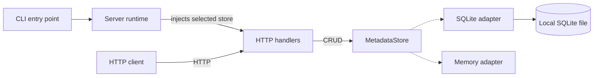
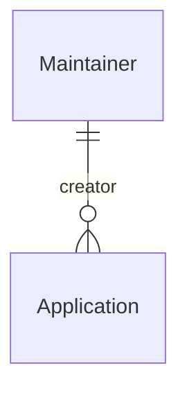

# Metadata API

[](https://github.com/henryzdai/metadata-api/actions/workflows/ci.yml)

Store application metadata and its creators through a Go JSON API.
Get full CRUD, SQLite persistence, and safe concurrent edits without a database server.

[API reference](openapi.json) | [Passing E2E run](https://github.com/henryzdai/metadata-api/actions/runs/39508357704) | [Workflow source](.github/workflows/ci.yml)

## Quick start

Use Go 1.27.2, the tested toolchain. The module requires Go 1.26 or later.
Normal builds need no C compiler.

Build and run from this directory:

```powershell
go run .\cmd\metadata-server
```

The server listens on `127.0.0.1:8080` and stores data in `data\metadata.db`.
Stop it with Ctrl+C. Run tests in another terminal:

```powershell
go test .\... -count=1
```

For a standalone Windows executable, run
`go build -o metadata-server.exe .\cmd\metadata-server`.
On Linux or macOS, use `./cmd/metadata-server` and `./...` instead.

Configure the address with `--listen`, the SQLite path with `--db`, or select
volatile storage with `--storage memory`.

## Create an application

Create its Maintainer first, then use the returned ID:

```powershell
$api = "http://127.0.0.1:8080"
$owner = Invoke-RestMethod "$api/v1/maintainers" -Method Post -ContentType application/json `
	-Body '{"name":"Example Owner","email":"owner@example.test"}'
$body = @{
	title = "Inventory"; version = "1.0"; company = "Example"
	maintainer_id = $owner.id
} | ConvertTo-Json
Invoke-RestMethod "$api/v1/applications" -Method Post -ContentType application/json -Body $body
```

Both resources support create, list, get, replace, and delete. The
[OpenAPI reference](openapi.json) defines payloads, endpoints, and error codes.
An Application has one immutable creator. Its business `version` is separate
from the server-managed `revision`.

## Prevent lost updates

**Atomic conditional writes prevent lost updates.** GET returns an ETag.
Send it in `If-Match` when replacing or deleting a record. Storage checks the
revision and performs the mutation atomically, so stale editors cannot overwrite
newer changes.

A missing condition returns `428`. An otherwise-valid stale mutation returns
`412`. Read the latest state and merge before retrying. PUT returns the updated
body without an ETag; GET supplies the next validator.

Run the conflict-and-restart scenario against the real executable:

```powershell
go test .\e2e -run TestConcurrentWritersAcrossRestart -count=1 -v
```

## Architecture

### Runtime and storage



The CLI, runtime, handlers, and selected adapter run in one process.
Startup injects one `MetadataStore` implementation into the handlers.
Dotted edges show alternatives, not replication or fallback.
The selected adapter owns atomic revision and creator checks.

### Creator relationship



Each Application has one immutable `maintainer_id`. A Maintainer can be the
recorded creator of zero or many Applications. Referenced Maintainers cannot be
deleted, and contact edits do not invalidate Application ETags.

## Design decisions

These choices prioritize a small, testable metadata service. The reasons explain
what each choice protects; the tradeoffs state what it does not provide.

| Decision | Why | Tradeoff |
| --- | --- | --- |
| Go, standard HTTP, JSON, and PUT | One executable and an explicit API without a large framework. | Handwritten routing and validation. PUT replaces mutable fields; no PATCH or YAML. |
| One immutable creator; unique lowercase ASCII email | Prevent orphaned Applications and ambiguous creator records. | No creator reassignment or multi-maintainer model. Email uniqueness is a contact policy, not authentication. |
| UUID IDs and a separate revision | Keep identifiers backend-neutral and concurrency independent of business `version`. | UUID order is not creation order. Pagination across requests is not a snapshot. |
| One aggregate `MetadataStore`; compiled adapters | Check revisions and relationships atomically across both resources, without a dynamic loader. | Each adapter must preserve the whole contract. Memory uses one lock but loses data on restart. |
| SQLite by default | Durable transactions without a separate database service. | Serialized writers on local disk, not a shared filesystem. Multi-host writes need another transactional backend. |
| Atomic ETag/If-Match mutations | Reject stale edits rather than silently lose another client's changes. | Clients must read and resolve conflicts. This does not provide exactly-once POST. |
| Strict input, request bounds, deadlines, and safe logs | Bound request work and diagnose failures without exposing payloads. | 64 KiB bodies and 100-item pages are fixed limits, not total-memory or database-size guarantees. |
| Shared unit contracts plus real-process HTTP E2E | Check backend parity and failures that handler-only tests miss. | Process isolation and cleanup add complexity. Some checks require Linux. |
| Loopback first; no authentication or TLS | Keep this MVP focused on metadata correctness rather than an identity platform. | Not ready for public exposure. Deployment needs an authenticated TLS boundary, monitoring, and backups. |

SQLite uses foreign keys, `BEGIN IMMEDIATE`, WAL, and FULL synchronization.
Success follows commit. Durability depends on storage honoring sync; use
SQLite-aware backups. Adapter initialization fails explicitly, with no fallback.

`maintainer_id` always records the original creator. Future handoffs or
co-maintainers would use a separate responsibility relationship and an explicit
schema migration, without reinterpreting this field. Those additions are outside
the MVP.

## Code map

| Path | Responsibility |
| --- | --- |
| [`cmd/metadata-server/`](cmd/metadata-server/) | Executable entry point and process signals. |
| [`internal/server/`](internal/server/) | Configuration, backend selection, listener, and shutdown. |
| [`internal/metadata/`](internal/metadata/) | Resource models, validation, revisions, and the storage contract. |
| [`internal/httpapi/`](internal/httpapi/) | Routing, JSON requests and responses, and ETag preconditions. |
| [`internal/storage/`](internal/storage/) | SQLite and memory adapters plus shared contract tests. |
| [`e2e/`](e2e/) | Real-process HTTP, concurrency, restart, and shutdown tests. |

## Verification

Unit and shared storage-contract tests cover validation and backend behavior.
Real-process HTTP tests check observable guarantees:

- Competing edits with the same ETag cannot both succeed; a rejected edit leaves the winner's data unchanged.
- Creating an Application while deleting its creator cannot leave an orphan.
- Editing a creator's contact details does not rewrite its Applications or invalidate their ETags.
- Committed SQLite data survives a process restart; memory-backed data does not.

For logs and coverage:

```powershell
.\verify.ps1
```

This requires PowerShell 7. If Go is not on PATH, pass `-GoExecutable` with its path.
Results are saved under `artifacts`.

The [successful MVP Linux CI run](https://github.com/henryzdai/metadata-api/actions/runs/39508357704)
passed unit tests, shared storage contracts, real-process HTTP E2E, the race
detector, and SIGTERM shutdown. It measured **91.3% statement coverage** across
`internal` and `cmd`, excluding the separate E2E server process.

Open the [verification job](https://github.com/henryzdai/metadata-api/actions/runs/39508357704/job/118922898078)
and expand **Real-process HTTP E2E** to see the API test output.

On Windows, the SIGTERM test skips. To run the race detector locally, use
`.\verify.ps1 -Race` with a supported C compiler.

## Status and effort

The verified MVP is preserved at [`mvp-v1`](https://github.com/henryzdai/metadata-api/tree/mvp-v1).
The [development timeline](docs/EVOLUTION.md) separates that baseline from
post-MVP improvements and records their decisions, tradeoffs, and evidence.

Initial MVP implementation, review, documentation, and publication spanned about
eight elapsed hours, including pauses. The initial prototype took about 1.5 hours
of that span. These are elapsed spans, not person-hours.
